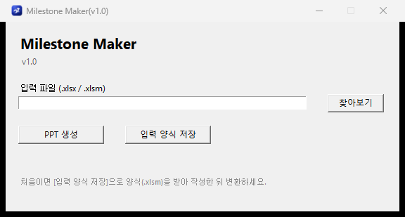
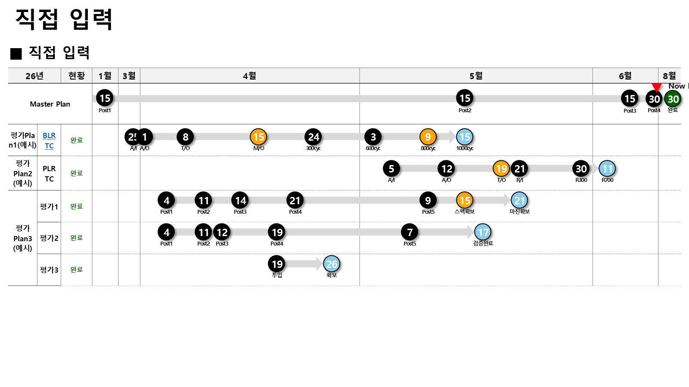

# Milestone Maker

**평가 일정표(Excel) → 마일스톤 PPT 자동 생성기.**
정해진 입력 양식(.xlsm)에 평가 항목·일정을 적으면, 슬라이드 한 장짜리 마일스톤 덱을 자동으로 그려줍니다.

## 사용법

1. 앱 실행 → **[입력 양식 저장]** 으로 빈 양식(.xlsm)을 받는다
2. 양식에 평가 항목·Post 일정·날짜를 채운다 (양식 안 자동화 버튼 지원)
3. **[PPT 생성]** → 저장 위치 선택 → 완료되면 폴더가 자동으로 열린다

CLI로도 동작합니다:

```bash
python main.py --input schedule.xlsm --output deck.pptx
```



## 생성 예시



## 빌드 (배포용 단일 .exe)

```bash
python -m venv .venv && .venv\Scripts\activate
pip install -r dev-requirements.txt
build.bat        # 또는: pyinstaller --noconfirm milestone_maker.spec
```

양식(.pptx/.xlsm)과 아이콘은 exe 안에 내장되어 단일 파일로 배포됩니다.

## 구조

| 파일 | 역할 |
|---|---|
| `main.py` | tkinter GUI + CLI 진입점 |
| `engine2.py` | 입력 파싱 → 슬라이드 레이아웃/도형 생성 (python-pptx) |
| `engine.py` | 공용 유틸(리소스 경로·Excel COM 폴백 등) |
| `assets/output.pptx` | PPT 템플릿 (흰 배경) |
| `assets/template_input.xlsm` | 입력 양식 (매크로 버튼 포함) |

> 이 저장소는 정화(sanitized) 미러입니다 — 배경 양식·설명서 등 사내 자료는 포함되지 않습니다.
